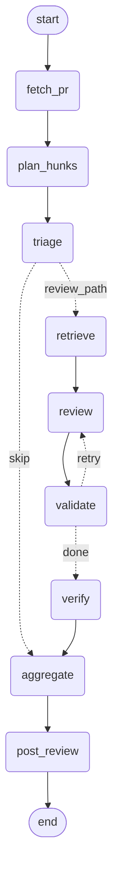

# Architecture: the review graph

The agent is a LangGraph state machine (`src/pr_agent/graph.py`). Every node is a thin
wrapper over a function that already existed and was tested on its own; the graph adds
**state, routing and checkpointing**, not review logic.

Regenerate from the code with `build_review_graph(...).get_graph().draw_mermaid()`.

## Nodes

| Node | Wraps | Reads | Writes |
| --- | --- | --- | --- |
| `fetch_pr` | `fetch_pull_request`, `fetch_changed_files` | `repo`, `pr_number` | `changed_files` |
| `plan_hunks` | `build_hunks` (drops noise files) | `changed_files` | `hunks` |
| `triage` | `triage_hunks` (free heuristics, no model) | `hunks` | `reviewable`, `skipped_trivial` |
| `retrieve` | `gather_context` | `reviewable` | `items` |
| `review` | `ReviewStep` (an `LLMReviewer`) | `items`, `attempts`, `dropped` | `candidates`, `attempts` |
| `validate` | `check_findings` | `candidates`, `hunks` | `validated`, `dropped` |
| `verify` | `Verifier` (a second, narrow model check; skipped if none) | `validated` | `verified`, `refuted` |
| `aggregate` | `aggregate_findings` | `verified` | `findings` |
| `post_review` | `post_review` | `findings` | `posted` |

## The two decisions

1. **After `triage`:** if no hunk is worth reviewing, jump straight to `aggregate`. No retrieval,
   no model call: the cost saving.
2. **After `validate`:** if the validator dropped any finding (it cited a line outside the diff) and
   `attempts <= max_retries`, go back to `review` with the stricter prompt, for the files that had
   drops only. Otherwise continue with what is grounded. `max_retries` (default 1) is the governor
   that stops a model that always hallucinates from looping.

## State, and why it is shaped this way

| Field | Behaviour | Why |
| --- | --- | --- |
| `candidates`, `dropped`, `attempts` | overwritten each pass | they describe the latest pass |
| `validated` | **merge reducer** (`merge_findings`) | grounded findings accumulate across the retry, without duplicates |
| `findings` | overwritten once, by `aggregate` | the final, sorted result. A reducer-managed field is append-only and cannot be re-ordered, so the final list is a separate field |

State holds plain data only. The GitHub client, `PullRequest`, and embedding model never enter it,
because a resumed process has none of them. `post_review` re-fetches the PR for that reason.

## Checkpointing and re-running

`checkpointing.py` builds a `MemorySaver` (tests) or a SQLite saver (survives a crash). Snapshots are
taken after every node, keyed by a thread id. `thread_id_for(repo, pr, head_sha)` puts the commit in
the key. `review_pull_request` looks at the thread's status first:

| Thread is | It does | Because |
| --- | --- | --- |
| new | runs from the start | |
| interrupted | resumes at the node that failed | finished nodes are not repeated |
| finished | returns the saved result | re-running the same commit never re-reviews or double-posts |

## What the reviewer is shown (`retrieve` node)

For each hunk, in priority order: **dependents** (code outside the diff that the change could
break, from `symbols.py` + `impact.py`), then **definitions** the changed code calls, then
**semantically similar** code. Every chunk carries a `reason`, and each hunk carries `notes`
(how many dependents exist, how many were shown, how many the PR already updated, or that none
were found). The prompt tells the model to report a broken caller **on the changed line**,
because the validator only accepts findings on added lines. The full scenario matrix, with what
is covered and what is not, is in [retrieval_scenarios.md](retrieval_scenarios.md).

## What running on real code taught us

The planted-bug suite showed no false positives. The first real commit (9 hunks of an actual
repository) produced **nine**, all wrong. Each cause got its own fix:

| Cause | Fix |
| --- | --- |
| Markdown was reviewed as code; the model invented a "120-character limit" | only source files are reviewed |
| A variable one hunk adds looked "unused" because another hunk uses it | all hunks of a file are reviewed in one call (also one copy of the instructions per file instead of per hunk) |
| "The directory is never created", but the callee creates it at the end of a 140-line function the model saw only the top of | the **verify** step re-reads the enclosing function and the callees' bodies (head and tail of long ones) and refutes claims the code answers; the prompt also forbids hedged claims about unseen code |
| `if __name__ == "__main__": main()` reported as a dependent of `main` | script-level calls in the changed file are ignored for body changes |
| A change that only deletes code could not be reported at all (findings must sit on an added line, and there is none) | for a deletion-only hunk, the context lines beside the removal are valid anchors; everywhere else the strict rule stands |
| The first version of the verifier rejected true findings about untouched callers ("report.py is not shown") | it is given the dependents retrieval found; the same helper feeds the graph and the evaluation |

Same commit, before and after: 9 findings and 9 model calls (22k tokens, 8 minutes) became 3
calls (7.7k tokens, 2 minutes), and the verifier refuted the two remaining false claims when
given them directly. A real bug (a wrong type annotation in PR #1) survives verification.

### Measured on the hard suite

`experiments/llm_eval.py --verify` on 18 planted cases (12 bugs in new code or in untouched callers, 2 older
callee-dependent bugs, 4 clean changes), `openai/gpt-oss-120b` at medium effort on Groq's free tier. The numbers come
from three runs because fixes landed between them, and the 8 original cases were not re-run on the final prompt:

| Run | Bugs found before verification | After | False positives before / after | Clean cases flagged |
| --- | --- | --- | --- | --- |
| 1: 18 cases, verifier not yet given dependents | 13 / 14 | 12 / 14 | 1 / 0 | 0 / 4 |
| 2: 4 impact cases, same harness bug | 4 / 4 | 1 / 4 | 1 / 0 | n/a |
| 3: 3 impact cases, final logic | 3 / 3 | 3 / 3 | 1 / 0 | n/a |

Run 2 is the instructive one: the verifier rejected three true findings because the harness did not give it the
dependents, which is what the fix above addresses. With the final logic every bug case that was found before
verification was still found after it, the one misplaced finding was removed, and no clean case was flagged. The
costs were about 2.1k tokens per reviewed file and about 0.9k per verified finding. Treat this as evidence the
mechanisms work, not as a quality rate: it is a small, synthetic, one-model sample.

## Where this deliberately differs from the field manual

1. **Reducer.** The manual puts `operator.add` on `findings` and has `validate` return the filtered
   list. An append reducer would *append* the survivors to the unfiltered list, keeping the
   hallucinated findings. Here raw, grounded and final findings are separate fields.
2. **Retry router.** The manual increments `retries` in `validate`, then checks `retries < 1` in the
   router, which reads the already-incremented value, so the retry never fires. Here `review`
   counts attempts and the router compares `attempts <= max_retries` (a mutation test pins this).
3. **"A re-run resumes."** Calling `invoke` on a *finished* thread re-runs every node on top of stale
   state (a leftover `attempts` made the second run take the retry path with no hunks). Only an
   *interrupted* thread resumes; hence the status check above and the commit in the thread id.

## Not built yet

The GitHub Action, reranking between `retrieve` and `review`, and impact analysis for languages
other than Python. A crash *between* posting and checkpointing could still post once more; the
hidden per-commit marker in the review body catches that on the next run.
