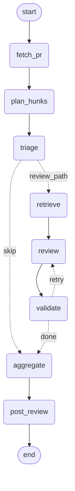

# Architecture: the review graph

The agent is a LangGraph state machine (`src/pr_agent/graph.py`). Every node is a thin
wrapper over a function that already existed and was tested on its own; the graph adds
**state, routing and checkpointing**, not review logic.

Regenerate from the code with `build_review_graph(...).get_graph().draw_mermaid()`.

## Nodes

| Node | Wraps | Reads | Writes |
| --- | --- | --- | --- |
| `fetch_pr` | `fetch_pull_request`, `fetch_changed_files` | `repo`, `pr_number` | `changed_files` |
| `plan_hunks` | `build_hunks` (drops noise files) | `changed_files` | `hunks` |
| `triage` | `triage_hunks` (free heuristics, no model) | `hunks` | `reviewable`, `skipped_trivial` |
| `retrieve` | `gather_context` | `reviewable` | `items` |
| `review` | `ReviewStep` (an `LLMReviewer`) | `items`, `attempts`, `dropped` | `candidates`, `attempts` |
| `validate` | `check_findings` | `candidates`, `hunks` | `validated`, `dropped` |
| `aggregate` | `aggregate_findings` | `validated` | `findings` |
| `post_review` | `post_review` | `findings` | `posted` |

## The two decisions

1. **After `triage`:** if no hunk is worth reviewing, jump straight to `aggregate`. No retrieval,
   no model call: the cost saving.
2. **After `validate`:** if the validator dropped any finding (it cited a line outside the diff) and
   `attempts <= max_retries`, go back to `review` with the stricter prompt, for the files that had
   drops only. Otherwise continue with what is grounded. `max_retries` (default 1) is the governor
   that stops a model that always hallucinates from looping.

## State, and why it is shaped this way

| Field | Behaviour | Why |
| --- | --- | --- |
| `candidates`, `dropped`, `attempts` | overwritten each pass | they describe the latest pass |
| `validated` | **merge reducer** (`merge_findings`) | grounded findings accumulate across the retry, without duplicates |
| `findings` | overwritten once, by `aggregate` | the final, sorted result. A reducer-managed field is append-only and cannot be re-ordered, so the final list is a separate field |

State holds plain data only. The GitHub client, `PullRequest`, and embedding model never enter it,
because a resumed process has none of them. `post_review` re-fetches the PR for that reason.

## Checkpointing and re-running

`checkpointing.py` builds a `MemorySaver` (tests) or a SQLite saver (survives a crash). Snapshots are
taken after every node, keyed by a thread id. `thread_id_for(repo, pr, head_sha)` puts the commit in
the key. `review_pull_request` looks at the thread's status first:

| Thread is | It does | Because |
| --- | --- | --- |
| new | runs from the start | |
| interrupted | resumes at the node that failed | finished nodes are not repeated |
| finished | returns the saved result | re-running the same commit never re-reviews or double-posts |

## What the reviewer is shown (`retrieve` node)

For each hunk, in priority order: **dependents** (code outside the diff that the change could
break, from `symbols.py` + `impact.py`), then **definitions** the changed code calls, then
**semantically similar** code. Every chunk carries a `reason`, and each hunk carries `notes`
(how many dependents exist, how many were shown, how many the PR already updated, or that none
were found). The prompt tells the model to report a broken caller **on the changed line**,
because the validator only accepts findings on added lines. The full scenario matrix, with what
is covered and what is not, is in [retrieval_scenarios.md](retrieval_scenarios.md).

## Where this deliberately differs from the field manual

1. **Reducer.** The manual puts `operator.add` on `findings` and has `validate` return the filtered
   list. An append reducer would *append* the survivors to the unfiltered list, keeping the
   hallucinated findings. Here raw, grounded and final findings are separate fields.
2. **Retry router.** The manual increments `retries` in `validate`, then checks `retries < 1` in the
   router, which reads the already-incremented value, so the retry never fires. Here `review`
   counts attempts and the router compares `attempts <= max_retries` (a mutation test pins this).
3. **"A re-run resumes."** Calling `invoke` on a *finished* thread re-runs every node on top of stale
   state (a leftover `attempts` made the second run take the retry path with no hunks). Only an
   *interrupted* thread resumes; hence the status check above and the commit in the thread id.

## Not built yet

A real `LLMClient` (Groq), reranking between `retrieve` and `review`, a summary comment and
idempotent inline posting (a crash *between* posting and checkpointing would post twice), config and
CLI, the planted-bug evaluation, and the GitHub Action.
